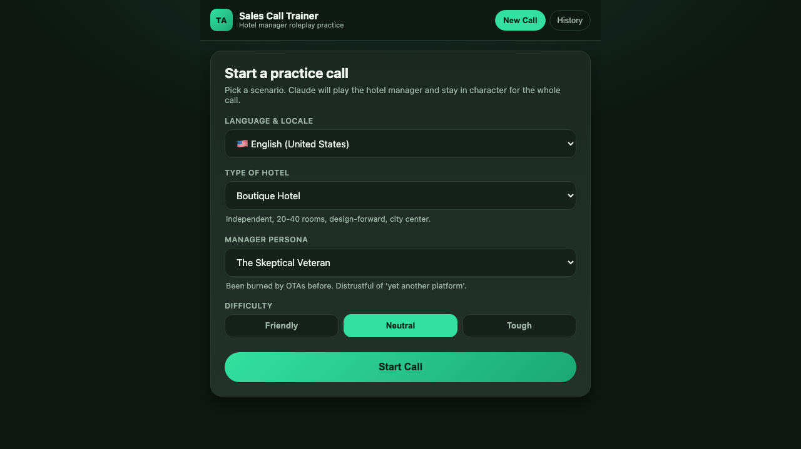
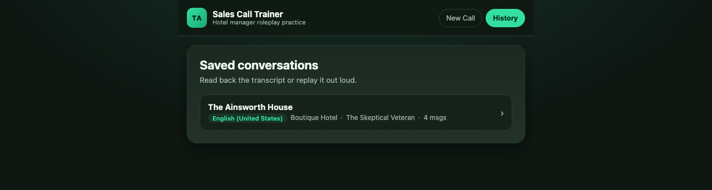
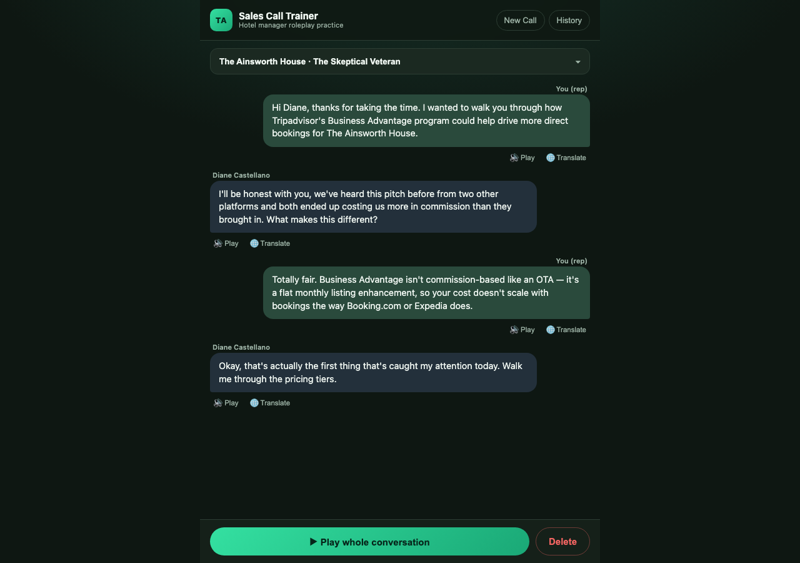

# Sales Call Trainer

A small web app for practicing Tripadvisor-style sales calls with hotel
managers. Claude plays a hotel manager persona and responds in character —
in English or Spanish (Spain, Mexico, Argentina, Colombia) — while you
practice pitching, handling objections, and asking questions, by voice or
by text. Conversations are saved so you can read the transcript back or
have it read aloud to you later.

## Screenshots

| Start a call | History | Transcript |
|---|---|---|
|  |  |  |

## Features

- **Text or voice input**, in English or Spanish, using the browser's
  built-in speech recognition (works best in Chrome/Edge on desktop or
  Android; Safari/iOS support varies).
- **Claude plays the hotel manager** — a specific persona (skeptical
  veteran, data-driven analyst, overwhelmed owner-operator, corporate
  gatekeeper, eager newcomer, review-anxious manager) at a hotel type you
  choose (boutique, luxury resort, business/chain, budget motel, B&B,
  extended-stay), reacting specifically to what you say and occasionally
  asking you questions back, just like a real call.
- **Spanish country locales** — Spain, Mexico, Argentina, Colombia — pick
  the accent/voice used for speech recognition and text-to-speech, and the
  country the invented hotel/manager is set in.
- **Saved conversations** — every call is stored (SQLite) and available
  under "History": read the transcript, replay any single line or the
  whole call out loud, and optionally see an on-demand translation of any
  line.
- **Difficulty levels** — friendly / neutral / tough — controls how easily
  the manager persona is persuaded and how many objections they raise.
- **Record a call as video** — capture the on-screen conversation (and the
  spoken audio, if you share tab audio) and save it as a video file on your
  own machine. See [Recording a call](#recording-a-call) below.

## How voice works

The Claude API doesn't do speech synthesis or recognition itself, so this
app uses the **browser's native Web Speech API** for both:

- **Speech-to-text** (`SpeechRecognition`) captures your spoken line and
  sends the transcribed text to Claude.
- **Text-to-speech** (`speechSynthesis`) reads the manager's reply back to
  you, in a voice matching the chosen locale, and is also used to replay
  saved conversations.

This keeps the app free of extra API keys/costs for voice and works
offline-ish on most phones, but voice quality and language coverage depend
on the voices installed on the device/browser, and `SpeechRecognition`
needs a secure context (HTTPS, or `localhost` during development).

The app avoids picking one of the "novelty" system voices your OS ships
(e.g. macOS's robotic `Albert` or `Zarvox`) and prefers normal-sounding
ones instead. On a Mac, for noticeably better quality than the default
system voice, install one of Apple's higher-quality voices for free: **☰
menu → System Settings → Accessibility → Spoken Content → System Voice →
Manage Voices…**, then download an "Enhanced" or "Premium" voice for your
language (e.g. Ava or Zoe for English) — the app will prefer those
automatically once installed.

Claude is used for the actual intelligence: playing the manager persona,
inventing each scenario (hotel name, manager name, situation), and
on-demand translation of any line between English and Spanish.

### Optional: higher-quality voices via ElevenLabs

For noticeably more natural, less robotic speech than any browser/OS voice,
set `ELEVENLABS_API_KEY` (see [Configuration](#configuration)) and the app
automatically switches to [ElevenLabs](https://elevenlabs.io)'s neural
text-to-speech instead — the browser's `speechSynthesis` becomes the
fallback if that key is missing or a request ever fails, so nothing breaks
if you don't set it up.

This is entirely optional and off by default. If you turn it on:

- **Cost**: billed per character by your ElevenLabs plan (roughly $5/mo for
  ~30,000 characters, up to ~$22/mo for ~100,000 — see
  [elevenlabs.io/pricing](https://elevenlabs.io/pricing), which changes over
  time, so check current tiers before subscribing). A typical practice call
  only synthesizes the manager's few short replies — a few hundred
  characters — so even daily use over a short interview-prep window should
  comfortably fit the free or cheapest paid tier. Each line is cached in the
  browser per saved message, so replaying the same call (e.g. "Play whole
  conversation") doesn't re-bill it.
- **How it works**: on your own machine (`./run.sh`) the server calls ElevenLabs
  with the key in `.env`, so the key never reaches the browser. On a shared
  server (`./serve.sh`, visitor mode) each visitor's own key stays in their
  browser and comes with the request; the server never stores it. Either way
  the MP3 is also cached on the server in `data/tts_cache/`, so a line spoken
  once is free afterwards.
- **Picking a voice**: defaults to a stable general-purpose ElevenLabs voice
  across every locale (English and all four Spanish ones). To use a
  different voice — e.g. one of ElevenLabs' native Spanish voices from their
  Voice Library — copy its Voice ID from the ElevenLabs dashboard and set
  `ELEVENLABS_VOICE_ID` (or `ELEVENLABS_VOICE_MANAGER`); `ELEVENLABS_VOICE_USER`
  sets the voice for your own lines when a call is replayed.

## Install on a Mac (no coding experience needed)

These steps get the app running on a Mac from scratch — you don't need to
know how to code, just copy/paste each command into Terminal.

1. **Open Terminal.** Press `Cmd + Space`, type `Terminal`, and press
   `Return`. A window with a text prompt will open — this is where you'll
   paste the commands below, pressing `Return` after each one.

2. **Install Homebrew** (a package installer for Mac). Paste this and press
   `Return`, then follow any on-screen instructions — it may ask for your
   Mac password (nothing will appear on screen as you type it, that's
   normal; just type it and press `Return`):

   ```bash
   /bin/bash -c "$(curl -fsSL https://raw.githubusercontent.com/Homebrew/install/HEAD/install.sh)"
   ```

   When it finishes, it may print 1-2 more commands under "Next steps" —
   copy and run those too, so Homebrew is usable in your Terminal.

3. **Install git and Python** using Homebrew:

   ```bash
   brew install git python
   ```

4. **Download this app.** This puts a copy in your home folder:

   ```bash
   git clone https://github.com/orancummins/translate.git ~/sales-call-trainer
   cd ~/sales-call-trainer
   ```

5. **Run it:**

   ```bash
   ./run.sh
   ```

   The first run takes a minute or two while it sets things up. When it's
   done, it prints `Open http://localhost:5050`.

6. **Open the app.** Go to that address in your web browser (Chrome or Edge
   work best, for the voice features). The first time it loads, it'll ask
   you to paste in a Claude API key — see [Getting an API
   key](#getting-an-api-key) below for where to get one. Paste it in and
   click **Save & Continue**; you only have to do this once.

Whenever you want to use the app again later, open Terminal, run
`cd ~/sales-call-trainer && ./run.sh`, and open
`http://localhost:5050` again. `./run.sh` restarts the app if it's already
running, so it's safe to run any time — but it only reinstalls Python
dependencies, it does **not** fetch new code changes on its own (see
below).

### Updating the app

This app is under active development, so new fixes and features land in
GitHub after you've first installed it. `./run.sh` does *not* pull those in
by itself — you need one extra command first:

```bash
cd ~/sales-call-trainer
git pull
./run.sh
```

`git pull` downloads the latest code; `./run.sh` then reinstalls anything
new the code depends on and restarts the app with it. Do this any time
something's been fixed and you want the update.

### Getting an API key

The app needs a Claude (Anthropic) API key to run the manager roleplay and
translations. This is a separate account from a Claude.ai chat
subscription, and API usage is billed separately (typically a few cents per
practice call).

1. Go to [platform.claude.com/settings/keys](https://platform.claude.com/settings/keys)
   and sign up or log in.
2. In the top-left workspace switcher, pick a workspace (use the "Default
   Workspace" if you don't have others).
3. Click **Create Key**, give it a name, and copy the key it shows you
   (starts with `sk-ant-...`) — it's only shown once.
4. Paste it into the app when prompted (or click the ⚙ icon in the app's
   top bar any time to update it later). The key is saved only in a local
   `.env` file on your own machine — it isn't sent anywhere except
   Anthropic's API.

## Manual setup (for developers)

```bash
pip install -r requirements.txt
python app.py
```

Then open `http://localhost:5050` and paste your API key when prompted, or
set `ANTHROPIC_API_KEY` in your environment or in a `.env` file before
starting the app.

### Configuration

| Env var | Default | Purpose |
|---|---|---|
| `ANTHROPIC_API_KEY` | — | Anthropic API credentials (or paste it into the app on first launch) |
| `CLAUDE_MODEL` | `claude-opus-5` | Model used for the manager roleplay & scenario generation |
| `CLAUDE_TRANSLATE_MODEL` | `claude-haiku-4-5` | Cheaper/faster model used only for the optional line translations |
| `PORT` | `5050` | Port Flask listens on |
| `BRAND` | `tripadvisor` | Which demo to run: `tripadvisor` (hotel sales) or `oyster` (global employment/EOR sales) |
| `ELEVENLABS_API_KEY` | — | Optional — enables higher-quality ElevenLabs voices; see [Optional: higher-quality voices via ElevenLabs](#optional-higher-quality-voices-via-elevenlabs) |
| `ELEVENLABS_VOICE_ID` | `21m00Tcm4TlvDq8ikWAM` | Optional — which ElevenLabs voice to use for every locale |
| `ELEVENLABS_MODEL_ID` | `eleven_multilingual_v2` | Optional — which ElevenLabs TTS model to use |

## Running a different company demo

The same app can run as two different pitches, switched with the `BRAND`
env var — everything downstream (company/persona lists, the scenario and
roleplay prompts, colors, and copy) follows from it:

```bash
BRAND=oyster ./run.sh
```

or for manual setup:

```bash
BRAND=oyster python app.py
```

Leave `BRAND` unset (or `BRAND=tripadvisor`) for the original hotel-sales
demo. Brand packs live in [brands.py](brands.py) — add a new one there
(company types, buyer personas, locales, colors, prompt phrasing) to
support a third demo without touching the rest of the app.

## Recording a call

Click **⏺ Record** during a call to save it as a video. Your browser will
ask you to pick what to share — choose **This Tab**, and turn on **Share
tab audio** so the manager's spoken voice is captured, not just the text.
Click **⏹ Stop & Save** (or use the browser's own "Stop sharing" control)
when you're done; the video downloads as a `.webm` file to your Downloads
folder, entirely on your own machine.

This uses the browser's built-in screen-recording APIs
(`getDisplayMedia`/`MediaRecorder`), so it works best in Chrome or Edge.
Safari's support is limited, and it can't capture tab audio at all in some
versions.

## Deploying for "on the go" use

To use voice features from your phone away from your home network, deploy
behind HTTPS (e.g. behind a reverse proxy with a TLS certificate, or a
platform that provides one) — `SpeechRecognition` requires a secure
context in most browsers. Text mode works anywhere.

## Project layout

```
app.py            Flask routes
brands.py         Per-company demo packs (Tripadvisor / Oyster) + active-brand selection
claude_client.py  Anthropic API calls (scenario generation, manager replies, translation)
personas.py       Tripadvisor hotel types, manager personas, locales, difficulty levels
db.py             SQLite persistence for sessions/messages
templates/         index.html — single-page app shell
static/css/        styling
static/js/         app logic, Web Speech API integration
data/               SQLite database file (gitignored)
```

## Voice settings at a glance

With an ElevenLabs key, the manager's replies (and your own lines when you replay a call) are spoken by ElevenLabs'
`eleven_multilingual_v2` model, which handles English and Spanish in the same voice. The audio is cached in
`data/tts_cache/`, so a line that has been spoken once costs nothing again. Without a key, or if a request fails, the
browser's own voices are used exactly as before.

- Voices: `ELEVENLABS_VOICE_MANAGER` (default Rachel, `21m00Tcm4TlvDq8ikWAM`) and `ELEVENLABS_VOICE_USER` (default Adam,
  `pNInz6obpgDQGcFmaJgB`); any voice id from your ElevenLabs library works.
- Keys: open the key icon in the top bar and paste a Claude key and, optionally, an ElevenLabs key.

## Two ways to run it

| | your own machine (`./run.sh`) | a shared server (`./serve.sh`) |
|---|---|---|
| `KEY_MODE` | `server` (default) | `visitor` |
| where keys live | `.env` here (see `.env.example`) | only in each visitor's browser, sent with each request |
| conversations | all on this machine | each browser sees only its own |
| web server | Flask's, with the debugger | waitress, no debugger, `127.0.0.1:$PORT` |

In visitor mode the server never stores a key and never reads one from `.env`, so nobody spends your credit: each person
pastes their own. It runs fine under a path prefix (`https://oran-dev.com/translate/`): nginx sends
`X-Forwarded-Prefix` and every link in the app is relative.

### Deploying to the dev server

The app is registered in `dev-server-page/services.json` as `translate` (port 5056, `https://oran-dev.com/translate/`,
`run: serve.sh`). From the dev Mac, in `~/dev/dev-server-page`: `make install` once (it asks for the server's password to
install the LaunchDaemon and nginx route), then `make app ID=translate` to pull and restart it, and `make landing` for the card.
